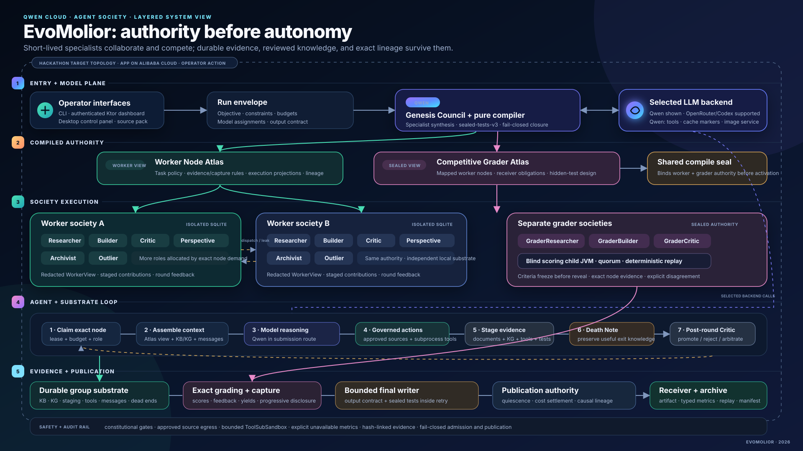

# Layered Architecture

**Deep interactive guide:** [`EvoMolior_Architecture.html`](EvoMolior_Architecture.html)

The HTML5 guide is the primary architecture document. It supports sticky layer navigation,
responsive layouts, exact implementation links, honest trust-boundary caveats, and browser
print/PDF export without external scripts or fonts.



PNG export: [`assets/evomolior-architecture.png`](assets/evomolior-architecture.png)

## Read The Diagram By Layer

| Layer | Authority |
|---|---|
| 1 — Entry + model plane | Operator interfaces create the run envelope; the selected backend supplies model execution, with Qwen Cloud used for the submission route and optional images. |
| 2 — Compiled authority | Genesis Council and deterministic compilers create separate Worker/Grader Atlases, sealed tests, receiver contract, and shared seal. |
| 3 — Society execution | Competing worker groups use isolated substrates while separate grader societies develop and freeze criteria. |
| 4 — Agent + substrate loop | An ordinary node-assigned worker claims an exact node, assembles bounded context, reasons, uses governed tools, stages evidence, and exits with a Death Note; Outliers and special-purpose workers use dedicated authority scopes. |
| 5 — Evidence + publication | Exact grading, capture, final-output validation, quiescence, cost settlement, metrics, replay, and manifests gate the receiver artifact. |

## Four Useful Zoom Levels

- **System:** objective and source pack to receiver artifact and replayable archive.
- **Group:** one competing society with a redacted WorkerView and isolated Room/SQLite substrate.
- **Agent:** one leased specialist operating through role, budget, TTL, tools, staging, and Critic
  authority.
- **Evidence:** one contribution carried through exact grading, capture, final lineage, validation,
  and publication.

## End-To-End Flow

1. **Operator and source pack** enter through the CLI, desktop control panel, or authenticated
   Ktor dashboard.
2. **Genesis Council** uses the selected Qwen Cloud model route to compile a typed execution
   envelope, sealed tests, disclosure policy, Worker Node Atlas, and separate Grader Atlas.
3. **Competing worker societies** receive redacted Atlas views. Short-lived specialised agents
   claim work, use role-gated tools, communicate, and stage contributions in group-isolated
   Room/SQLite substrates.
4. **Critic authority** promotes, rejects, or arbitrates staged documents, KG facts, tools,
   simulations, and deliverable components.
5. **Grader societies** freeze criteria before evidence reveal, evaluate exact node bundles, and
   return isolated blind scores. Scores drive capture, delayed yields, feedback, and progressive
   disclosure.
6. **Publication** validates the final candidate against its output contract and sealed tests,
   waits for quiescence and settled reservations, then emits the receiver artifact, replay, typed
   metrics, and hash-linked manifest.

## Qwen Cloud Boundary

Qwen Cloud/DashScope powers:

- Council and ordinary agent model calls when `-llm-backend qwen-cloud` is selected;
- structured output and function/tool calling;
- long-context cache annotations and token metadata;
- maintained direct single-Qwen benchmark baselines;
- optional `qwen-image-2.0-pro` final-asset generation.

Relevant implementation:

- `evomolior/agents/src/main/kotlin/com/achulkov/evomolior/agents/factory/LlmExecutorFactory.kt`
- `evomolior/agents/src/main/kotlin/com/achulkov/evomolior/agents/factory/DashscopeToolCompatibleLLMClient.kt`
- `evomolior/api/src/main/kotlin/com/achulkov/evomolior/api/service/QwenImageGenerationService.kt`

## Security And Isolation Boundaries

- group-local canonical state lives in separate SQLite databases;
- native tool calls pass constitutional action gates;
- source access is approval- and allowlist-based with redirects disabled;
- generated tools execute through bounded child processes;
- blind scoring runs in a separate authenticated loopback child JVM;
- normal role agents are currently in-process;
- Shuru microVM execution exists as an optional alternate branch.

## Deployment Shape

The Docker image starts the authenticated Ktor dashboard and CLI supervisor. On Alibaba Cloud, the
intended hackathon deployment is:

```text
Internet / judge browser
        |
     HTTPS
        |
Alibaba Cloud ECS or container host
        |
Docker: EvoMolior Ktor dashboard + CLI runtime
        |
Persistent data volume for run metadata and artifacts
        |
Qwen Cloud / DashScope APIs
```

Deployment proof is intentionally a separate operator action. See
[`Alibaba_Cloud_Deployment_Proof.md`](Alibaba_Cloud_Deployment_Proof.md).
